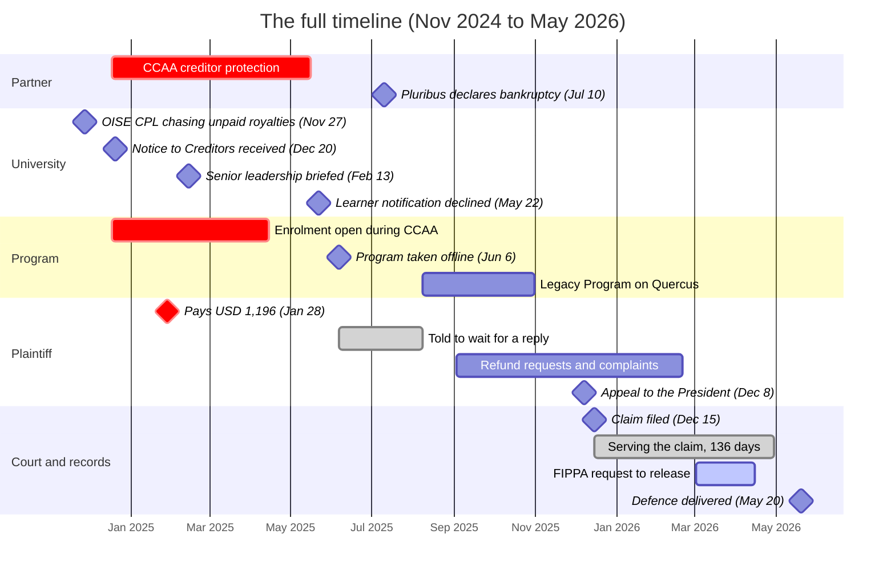
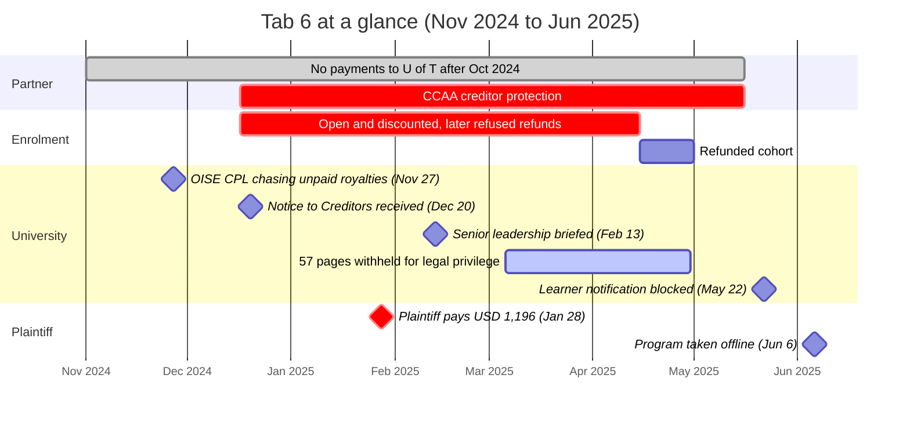

# University-of-Toronto-OISE-TEFL-Certificate-Scandal

This archive is a work in progress. The principal documents are available now, and further records will be added. Readers are invited to examine the sources and reach their own conclusions.

[see here](https://github.com/whistleblower33/University-of-Toronto-OISE-TEFL-Certificate-Scandal/blob/main/Plaintiffs_Brief_Tabs_1-6.pdf)

## University of Toronto OISE TEFL Certificate Scandal: A case study in institutional failure and cover-up.

In January 2025, the Plaintiff paid $1,196.00 USD for a "150-hour OISE TEFL online course," sold under the University of Toronto's name and crest (Tab 1). Six weeks earlier, the University's third-party delivery partner (Teach Away/Kesson Group) had entered court-supervised creditor protection, and five days before the payment its parent company publicly announced it was putting the business up for sale.

When the program abruptly shut down in June 2025, leaving students stranded, the Plaintiff requested a refund. The University directed students to a bankrupt entity that they knew had no money to pay creditors.

The Plaintiff filed Freedom of Information (FIPPA) requests. The internal emails the Plaintiff obtained reveal that the University received formal notice in December 2024, and that its senior program leadership was personally briefed by February 13, 2025, while enrolment remained open.

## Key Findings from the FOI Documents (FIPPA Release 26-R023)

[see here](https://github.com/whistleblower33/University-of-Toronto-OISE-TEFL-Certificate-Scandal/blob/main/FIPPA_26-R023_Released_Records.pdf)

**The Knowledge:** The University received a formal Notice to Creditors in December 2024, over a month before the Plaintiff paid. Internal emails show they were chasing over $142,000 in unpaid royalties from their partner as early as November 2024.

### The Motive: The "Post-Filing" Royalty Promise

**The Contractual Right:** The partner had stopped paying long before the insolvency. The University was chasing unpaid royalty invoices dated June 1 and August 31, 2024 ($75,255.92 and $65,203.71), and an invoice from April 18, 2023 (R-1). For months before the CCAA order of December 17, 2024, nothing prevented the University from acting on that breach. It didn't. An undated internal draft termination letter from April 2025 later cited the same non-payment as a material breach, stating, in a position "grounded in the agreement's terms and conditions," that early termination was "warranted and required" (R-107–111). By then the CCAA stay applied: the Notice to Creditors restrained anyone with an agreement with the partner from terminating it, as long as charges arising after the CCAA order were paid (R-13–14).

**The Insolvency Notice:** On December 20, 2024, UofT received a formal Notice to Creditors. The pre-filing arrears (over $140,000) were legally frozen by the CCAA stay.

**The Promise:** On February 12, 2025, the President of the insolvent partner's parent company wrote to UofT's Associate Director, explicitly stating: "Kesson intends to make payments to the University of Toronto for royalty amounts owed after the date of the Initial Order." Payment after the Initial Order was exactly the condition under which the stay kept the agreement in force.

**The Result:** Despite knowing the partner was insolvent, the University allowed the storefront to remain open. Internal emails show the University's own Senior Financial Analyst documenting that "Enrollment still open as of February 13, 2025," while the Executive Director named "our program risk and learner needs" as concerns. The University did not demand that the partner "Cease All New Registrations" until April 25, 2025, with a May 1 deadline (R-117–118).

**The Blocked Warning:** On May 20, 2025, the insolvent partner offered to send a warning email to learners. On May 21, UofT's Associate Director agreed it was "of benefit to share with learners." On May 22, the Executive Director overruled him, stating there was "no requirement" to send the warning. No email was ever sent.

**The Deflection:** The University's public FAQ directed students to request refunds from the bankrupt third party. However, internal emails show UofT knew by May 20, 2025, that this belonged to a bankrupt estate with zero funds available for unsecured creditors.

**The Script:** When students complained, internal emails show UofT leadership instructing staff to "gently push back on any suggestion that we engaged in misrepresentation so as to preserve our legal and reputational position."

*Disclaimer: This archive is published in the public interest for educational, journalistic, and research purposes.*

This is the Full and Final Release that the University of Toronto presented in exchange for the refund. It is published unredacted (except for the physical signature) because the terms are unconscionable. The University demanded a lifetime gag order and a waiver of the Plaintiff's human rights for a $1,335 refund. The Plaintiff did not fully consent to it, and the clause was never discussed during phone negotiations. The Plaintiff was experiencing TBI flare-ups at the time of signature.

The Plaintiff sought reimbursement for an undelivered course, not payment in exchange for silence. The approximately US$1,335 discussed during the phone negotiations was calculated from the US$1,196 course fee, approximately US$52 in interest, and approximately US$87 in disbursements—the estimated US-dollar equivalent of CAD$118. That calculation contained no separate amount for confidentiality.

Confidentiality was not discussed during the phone negotiations, according to my recollection, but appeared in the written release the Plaintiff was subsequently asked to sign. The Plaintiff objects to attaching continuing restrictions on public discussion to the resolution of this refund dispute. The agreement is reproduced here so readers can examine the terms themselves.

[see here](https://github.com/whistleblower33/University-of-Toronto-OISE-TEFL-Certificate-Scandal/blob/main/release_scan_clean.pdf)

## Criminal or Civil?

*This document represents the Plaintiff's legal theory and analysis based on documentary evidence. It is published for the purposes of public interest, legal research, and accountability. All claims are allegations to be proven in a court of law.*

[see here](https://github.com/whistleblower33/University-of-Toronto-OISE-TEFL-Certificate-Scandal/blob/main/UofT_Fraud_Theory_Timeline.pdf)

The Plaintiff believes this was fraud, and these documents record what happened when the Plaintiff tried to report it.

**16 September 2025: Canadian Anti-Fraud Centre.** The Plaintiff filed a report (reference 2025-81555). The CAFC collects fraud reports but does not investigate them, and the Plaintiff never heard from it directly.

[see here](https://github.com/whistleblower33/University-of-Toronto-OISE-TEFL-Certificate-Scandal/blob/main/CAFC%20Fraud.pdf)

**23 September 2025: RCMP, first complaint.** The Central Intake Unit for Ontario had the complaint reviewed and closed it as "a wholly civil matter" (case 2025-1409258).

**15–16 December 2025: RCMP, second complaint.** The Plaintiff asked for the case to be reopened with new evidence. The reply said that as a complainant outside Canada the Plaintiff had to go through the FBI, which could forward the complaint to RCMP headquarters, and that it would then most likely be passed to the Toronto Police Service.

[see here](https://github.com/whistleblower33/University-of-Toronto-OISE-TEFL-Certificate-Scandal/blob/main/RCPMP_Chain_criminal_fraud_or_civil_fraud.pdf)

**17 December 2025: FBI.** The Plaintiff filed a complaint with the Internet Crime Complaint Center (IC3) as instructed.

[see here](https://github.com/whistleblower33/University-of-Toronto-OISE-TEFL-Certificate-Scandal/blob/main/IC3_Complaint.pdf)

## Case timeline: Aders v. Governing Council of the University of Toronto

Court File No. SC-25-00014152-0000 (Toronto Small Claims Court)

The first chart shows the whole case. The second zooms in on the months when the program's delivery partner was insolvent, using the University's own records from FIPPA release 26-R023. The table below lists every dated event with its source. "Tab" refers to the Plaintiff's document brief (Tabs 1–6); **R-** numbers are page numbers in the FIPPA release.

### Close-up: the insolvency months

The release dates the 57 withheld pages only as "March–April 2025," so that bar is approximate.

### How many students were refused refunds?

Refunds were issued only to learners who registered on or after April 15, 2025. Everyone who registered from December 17, 2024 (the CCAA order) to April 14, 2025 was told that "refunds will not be issued" (R-130, R-132).

**At least 104 students enrolled inside that window**: 53 in January and 51 in February 2025, according to the partner's quarterly sales report (R-103–106). The full number isn't in the release:

- **December 2024:** the report gives 51 enrolments for the month but doesn't split them by date, so the release doesn't show how many came on or after December 17. The per-student breakdown ("Appendix A," an .xlsx file referred to on R-106) was not produced.
- **March 1 – April 14, 2025:** the partner's counsel says a "March 1st to April 15th report" was sent to OISE (R-124–126). It is not among the 181 pages released.

**Note on the report's own figures.** The report's headline gives 155 enrolments for Dec 1, 2024 – Feb 28, 2025, but its "Total number of students enrolled by month" table totals 134. The difference is December: the monthly table shows 30, which is the Canadian figure alone. The 21 December sales outside Canada (13 at 120 hours, 8 at 150 hours) are missing, and the December total cell in the outside-Canada table is also blank. With them included, December is 51 and the quarter is 155, which matches the headline.

| Month | Canada | Outside Canada | Total | Report's monthly table |
|---|---|---|---|---|
| Dec 2024 | 30 | 21 | **51** | 30 |
| Jan 2025 | 41 | 12 | 53 | 53 |
| Feb 2025 | 29 | 22 | 51 | 51 |
| **Quarter** | | | **155** | **134** |

The report also lists one Canadian enrolment in November 2024, which is why its Canada table totals 101 (101 + 55 = 156).

### Every dated event

| Date | Event | Source |
|---|---|---|
| **1. Background and the partner's insolvency** | | |
| Aug 21, 2020 | Master Agreement between Kesson Group Inc. and U of T (OISE) | Tab 6, R-114 |
| Apr 18, 2023 | Invoice K17-11-461 ($2,475.84) issued to the partner; still unpaid in 2025 | Tab 6, R-1 |
| Oct 2024 | Last payment U of T receives under the agreement | Defence ¶13 |
| Nov 27, 2024 | OISE CPL emails the partner about overdue payments | Tab 6, R-1 |
| Dec 17, 2024 | CCAA Initial Order: Pluribus/Kesson enter creditor protection; announced publicly the same day | Defence ¶14; Tab 6, R-12–15 |
| Dec 20, 2024 | Monitor's Notice to Creditors received by U of T Accounts Receivable | Tab 6, R-12–15; Tab 3, Item 3.4 |
| Dec 27, 2024 | Amended and Restated Initial Order | Tab 6, R-17–43 |
| Jan 23, 2025 | Pluribus publicly announces a court-supervised sale process, naming Kesson | Public record; Tab 3 |
| **2. The payment, and what the University knew** | | |
| **Jan 28, 2025** | **Plaintiff pays USD $1,196.00 for the "150-hour OISE TEFL online course" (Order #3762). Receipt, enrolment and welcome emails are branded "OISE University of Toronto"** | Tab 1, Ex. 1.1–1.3 |
| Jan 31, 2025 | OISE CPL chases $142,935.47 across three invoices (cc Cassidy) | Tab 6, R-1–2 |
| Feb 12, 2025 | Pluribus president to Cassidy: CCAA explained; only post-filing royalties will be paid | Tab 6, R-4–5; Defence ¶15 |
| Feb 13, 2025 | Cassidy briefs Executive Director Rees-Johnstone | Tab 6, R-4–5 |
| Feb 13, 2025 | Rees-Johnstone notes the $140,520.54 creditor listing and the Dec 20 notice; refers to legal counsel | Tab 6, R-3 |
| Feb 13, 2025 | Analyst: enrolment still open, 20% discount live at checkout | Tab 6, R-3, R-6–9 |
| Feb 28, 2025 | Quarterly report: 155 enrolled Dec–Feb; $60,580.09 royalties due to U of T | Tab 6, R-103–106 |
| Mar 5–6, 2025 | "Update & Next Steps" meeting of four officials | Tab 6, R-44–45 |
| Mar–Apr 2025 | 57 consecutive pages withheld (solicitor-client privilege, FIPPA s. 19) | Tab 6, R-46–102 |
| Apr 2025 | Draft termination for non-payment of royalties; never sent | Tab 6, R-107–111 |
| Apr 15, 2025 | Accounts Receivable: "We had one in December" | Tab 6, R-10–11 |
| Apr 16, 2025 | Kesson disclaims the Master Agreement (effective May 16) | Tab 6, R-114–115 |
| Apr 16, 2025 | Student complaint marked "ACTION REQUIRED" reaches the Dean's office | Tab 6, R-112–113 |
| Apr 25, 2025 | Wind-down annex: stop registrations by May 1; refunds for post-disclaimer enrollees only | Tab 6, R-117–118, R-124 |
| May 5, 2025 | Partner's counsel transfers course files and learner records; post-Apr 15 refunds confirmed | Tab 6, R-124–126 |
| May 7, 2025 | Rees-Johnstone circulates the partner's T&Cs and draft learner FAQs | Tab 6, R-141–162 |
| May 14, 2025 | U of T asks about refunds for Dec 17, 2024 – Apr 14, 2025 enrollees | Tab 6, R-131–132 |
| May 16, 2025 | Master Agreement disclaimed | Tab 6, R-114 |
| May 20, 2025 | Partner's counsel: no refunds for that cohort, "no funds available"; offers to email learners | Tab 6, R-130, R-132 |
| May 21, 2025 | Cassidy: learner email "is appropriate" | Tab 6, R-129–130 |
| May 22, 2025 | Rees-Johnstone reverses; no notification is ever sent | Tab 6, R-127–129 |
| **3. Shutdown and the "migration"** | | |
| **Jun 6, 2025** | **Program taken offline. Plaintiff asks about his progress; OISE CPL asks him to wait and not send more emails** | Tab 2, Ex. 2.1 |
| Jun 9, 2025 | Internal reply to a "Scam" complaint: "preserve our legal and reputational position" | Tab 6, R-165–171 |
| Jul 10, 2025 | Pluribus (now 1000128977 Ontario Inc.) declares bankruptcy | Tab 3, Item 3.7 |
| Jul 17, 2025 | Access date in an internal draft learner email (Quercus migration); no sent version in the release | Tab 6, R-180–181 |
| Aug 1, 2025 | Plaintiff contacts OISE CPL through its inquiry form | Tab 2, Ex. 2.3 |
| Aug 8, 2025 | "Successfully migrated" email: program moved to Quercus, learners can continue | Tab 2, Ex. 2.2 |
| Aug 8, 2025 | Two options offered: Legacy Program until Oct 31, or a New Program (Nov 2025) with 125 hours, no specializations and no progress transfer | Tab 2, Ex. 2.3 |
| Aug 11, 2025 | Plaintiff raises a refund; OISE CPL directs refund inquiries to Pluribus; Legacy extension needs medical or other documentation | Tab 2, Ex. 2.3 |
| Sep 25, 2025 | Plaintiff starts the Legacy Program; advisor says earlier progress can't be shown on the new platform; extension approved in principle, length left open | Tab 2, Ex. 2.4; Tab 3, Item 3.6 |
| Oct 31, 2025 | Legacy course closing; Plaintiff asks about the extension again; no period is ever confirmed | Tab 2, Ex. 2.4 |
| **4. Seeking a refund** | | |
| Sep 3, 2025 | Plaintiff emails Teach Away and Pluribus | Tab 3, Items 3.7–3.8 |
| Sep 4, 2025 | Plaintiff writes to the U of T Office of the Ombudsperson | Tab 3, Item 3.1 |
| Sep 5, 2025 | Ombudsperson declines (continuing education is outside its mandate); Plaintiff sends a refund demand to Dean Walker | Tab 3, Items 3.1–3.2 |
| Sep 7, 2025 | GlassRatner (Pluribus CCAA) refers Plaintiff to the trustee | Tab 3, Item 3.7 |
| Sep 8, 2025 | Dean acknowledges. Teach Away declines a refund and confirms OISE CPL "now solely owns and operates" the course, including payments | Tab 3, Items 3.2, 3.8 |
| Sep 9, 2025 | Abdullah offers a call; Plaintiff requests a refund by cheque, in writing | Tab 3, Item 3.3 |
| Sep 11, 2025 | Trustee: company bankrupt, no funds for refunds; Statement of Affairs attached | Tab 3, Item 3.7 |
| Sep 16, 2025 | Canadian Anti-Fraud Centre complaint | Tab 3, Item 3.9 |
| Sep 18, 2025 | Complaints to Consumer Protection Ontario and the Ministry of Colleges and Universities | Tab 3, Items 3.10–3.11 |
| Sep 19, 2025 | U.S. Federal Trade Commission report | Tab 3, Item 3.12 |
| Sep 23, 2025 | Abdullah: a U of T Accounts Receivable contact "received the Notice to Creditors in December 2024" | Tab 3, Item 3.4 |
| Sep 23, 2025 | Cassidy takes over the file; RCMP declines the complaint as "wholly civil" | Tab 3, Items 3.5, 3.13 |
| Sep 24, 2025 | Cassidy: matter is "a priority," hopes to connect; no follow-up | Tab 3, Item 3.5 |
| Oct 21, 2025 | Consumer Protection Ontario declines to act | Tab 3, Item 3.10 |
| Dec 8, 2025 | Appeal to President Woodin (cc Dean Walker, Cassidy) | Tab 4, Ex. 4.1 |
| Dec 13, 2025 | Plaintiff writes to the U.S. Consulate General Toronto | Tab 3, Item 3.14 |
| Dec 15, 2025 | Plaintiff recontacts the RCMP with new evidence | Tab 3, Item 3.13 |
| Dec 16, 2025 | Consulate declines; RCMP refers the foreign complaint to the FBI | Tab 3, Items 3.13–3.14 |
| Dec 17, 2025 | FBI Internet Crime Complaint Center (IC3) complaint | Tab 3, Item 3.15 |
| Feb 20, 2026 | Ministry of Colleges and Universities declines to intervene | Tab 3, Item 3.11 |
| **5. The court case** | | |
| **Dec 15, 2025, 12:28 a.m.** | **Claim submitted to Toronto Small Claims Court** | Tab 5, Item 5.1 |
| Dec 15, 2025, 9:30 p.m. | Cassidy's reply on the President's behalf: refund refused, three options | Tab 4, Ex. 4.2 |
| Dec 18, 2025 | Plaintiff emails the issued Claim to the Governing Council | Tab 5, Item 5.2 |
| Dec 22, 2025 | University Counsel rejects service by email | Tab 5, Item 5.3 |
| Dec 30, 2025 | Process server quotes a $500 USD retainer for personal service | Tab 5, Item 5.4 |
| Jan 6, 2026 | Fee waiver granted | Tab 5 |
| Jan 13, 2026 | Motion for substituted service sworn (accepted for filing about Jan 19) | Tab 5, Item 5.5 |
| Mar 2, 2026 | Court: motion still in queue. Same day, Plaintiff files FIPPA request | Tab 5, Item 5.6; Tab 6 |
| Apr 1, 2026 | U of T extends the FIPPA deadline | Tab 6 |
| Apr 15, 2026 | FIPPA release 26-R023: 181 pages | Tab 6 |
| Apr 23, 2026 | Plaintiff's second status inquiry to the court; no reply | Tab 5, Item 5.6 |
| Apr 28, 2026 | Deputy Judge B. Grant orders substituted service by email | Tab 5 |
| Apr 30, 2026 | Claim served by email, 136 days after filing | Tab 5 |
| May 2, 2026 | Affidavit of Service sworn | Tab 5 |
| May 20, 2026 | Defendant delivers its Defence | Tab 5 |
